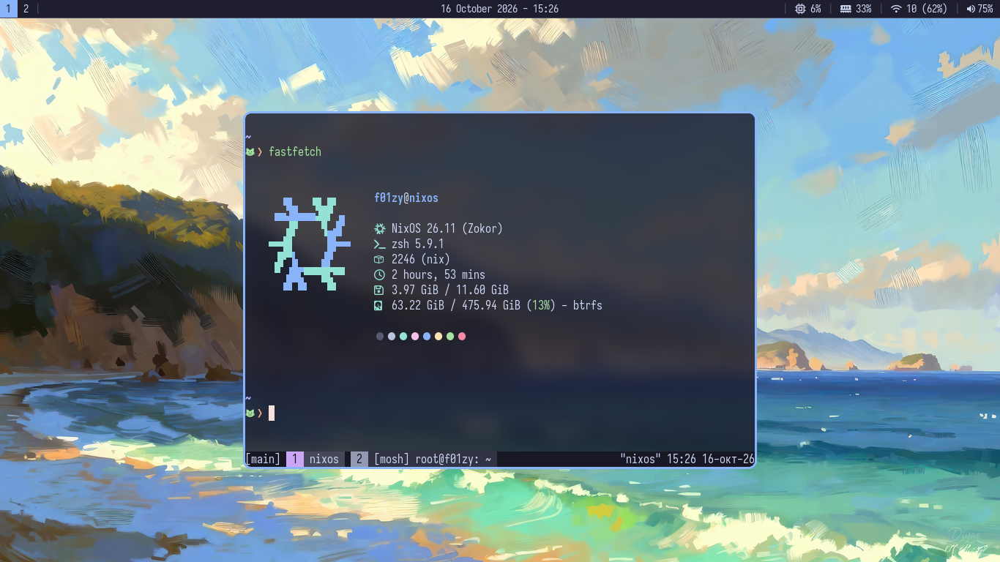

# ❄️ Dotfiles

<picture>
  
</picture>

> [!NOTE]
> **System Information:**
> * **OS:** NixOS
> * **Window Manager:** Swayfx
> * **Shell:** Zsh
> * **Terminal:** Foot 
> * **Editor:** Nixvim

## Installation

This guide assumes you have a fresh NixOS installation with Flakes enabled.

1. Clone the repository to your preferred location:
```bash
git clone https://github.com/f01zy/dotfiles.git ~/.dotfiles
cd ~/.dotfiles
```

2. Copy the hardware configuration from your current system:
```bash
cp /etc/nixos/hardware-configuration.nix ./hosts/device-name/
```

3. Edit the variables (username, host) in `flake.nix` to match your setup.
4. Apply the system configuration:
```bash
sudo nixos-rebuild switch --flake .#hostname
```
